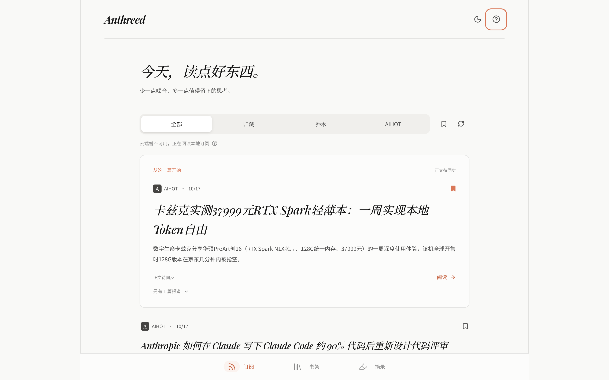
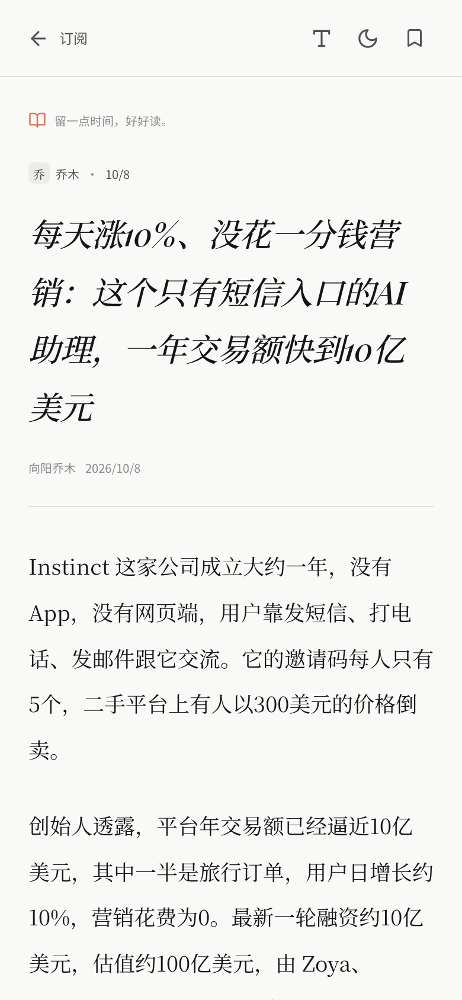
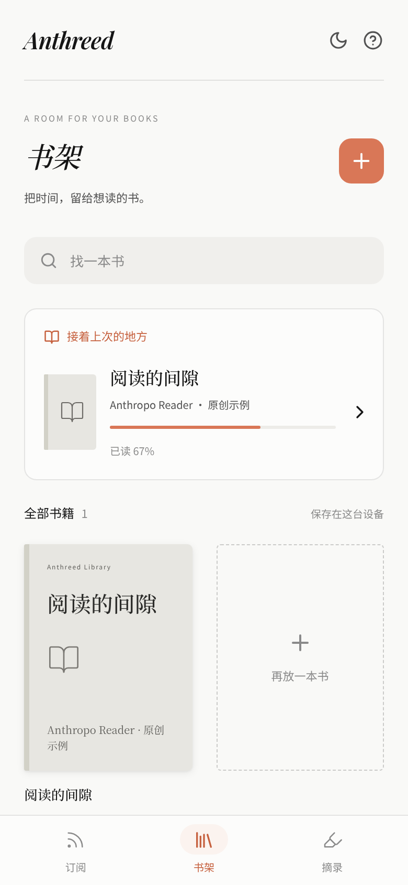
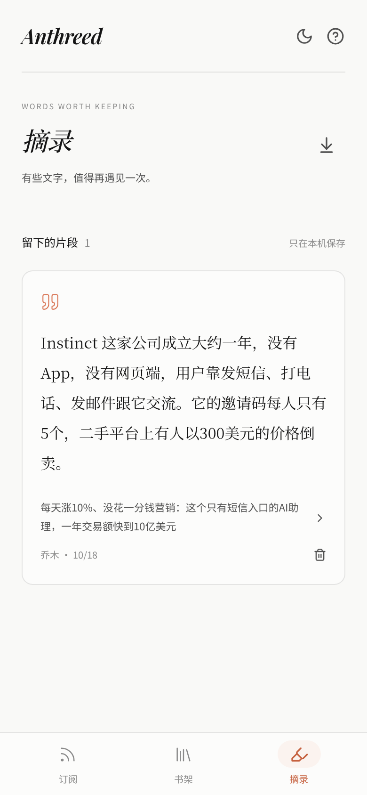
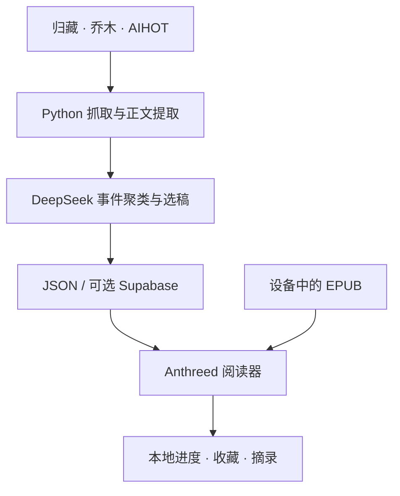

  

  <h1>Anthreed</h1>

  
<strong>把注意力留给值得读的内容。</strong>

  
一处安静的阅读空间。发现好文章，读完一本书，留下想要重读的句子。

  

    <a href="#preview">界面预览</a> ·
    <a href="#features">功能</a> ·
    <a href="#getting-started">本地运行</a> ·
    <a href="#how-it-works">工作原理</a>
  

  

    
    
    
    
  

A quieter place to read.

  

<table>
  <tr>
    <td width="33%"></td>
    <td width="33%"></td>
    <td width="33%"></td>
  </tr>
  <tr>
    <td align="center">沉浸式文章阅读</td>
    <td align="center">自己的 EPUB 书架</td>
    <td align="center">留下值得重读的文字</td>
  </tr>
</table>

Features
01 / Discover · 少一点信息噪音
- 聚合精选来源：目前接入 归藏、乔木 和 AIHOT。
- 按事件去重：使用 DeepSeek 对不同来源的报道分组，为同一事件挑选一篇值得细读的文章；可以查看其他报道及选稿原因。
- 轻松筛选：按来源查看、搜索、收藏；支持将不感兴趣的卡片划走。
- 读得完整：在应用内阅读抓取到的正文；暂未同步的文章会明确提示，不用摘要假装全文。
02 / Read · 让阅读回到阅读本身
- 本地 EPUB：导入设备上的非 DRM EPUB，建立私人书架，并提供内置示例书。
- 专注阅读器：目录、翻页或滚动模式、字号、行距、明暗主题与阅读进度续读。
- 轻量而克制：适配手机、平板和桌面屏幕，保留文字的呼吸感。
03 / Keep · 留下真正有价值的东西
- 随手摘录：保存文章或书籍中选中的文字，附带来源信息。
- Markdown 导出：把摘录带走，而不是困在应用里。
- 本地优先：书籍文件、阅读位置和摘录保存在浏览器 IndexedDB 中；EPUB 文件不会上传到云端。

Getting started
当前主要开发入口位于 web/，使用 React + TypeScript + Vite。需要 Node.js 20.19+。
git clone https://github.com/StanHuanng/Anthreed.git
cd Anthreed/web
npm ci
npm run dev
在浏览器访问 http://127.0.0.1:48740。

仓库已包含一份 data/articles.json，因此无需先配置 AI API 或数据库也能体验现有订阅内容。还可以在「书架」试读内置 EPUB。

<strong>更新订阅数据</strong>

在仓库根目录运行：
python3 -m venv .venv
source .venv/bin/activate
pip install -r fetchers/requirements.txt
cp .env.example .env
在 .env 中填写 DEEPSEEK_API_KEY，然后执行：
python -m fetchers.run
抓取程序会更新 data/articles.json 等数据文件。模型不可用时会优先保留此前经过 AI 选稿的内容；初次运行则使用明确标注的本地去重结果。

SUPABASE_URL、SUPABASE_ANON_KEY 和 SUPABASE_SERVICE_ROLE_KEY 是可选云端同步所需的配置。具体数据库初始化与迁移见 开发说明。不要将 .env 或服务端密钥提交到仓库。

<strong>构建与检查</strong>

cd web
npm run typecheck
npm run check:tokens
npm run build
Python 的抓取与同步模块有单元测试；浏览器端检查脚本 npm run qa 需要可用的 Chrome 环境。

How it works

目录	用途
[`web/`](web/)	当前 React 阅读应用、EPUB 阅读器，以及 Capacitor Android 工程
[`fetchers/`](fetchers/)	文章抓取、正文提取、AI 选稿与云端同步
[`data/`](data/)	本地文章、选稿记录和来源缓存
[`supabase/`](supabase/)	可选的云端数据库结构
[`qa/`](qa/)	界面截图、检查脚本与开发记录
[`app/`](app/)	早期 Flutter 实现，独立保留，不是当前 Web 入口

数据与隐私：AI 选稿发生在 Python 端；前端仅使用可公开的 Supabase URL 和 anon key。浏览器可从云端读取订阅数据，云端不可用时回退到本地数据与已有缓存。书籍、摘录和阅读进度保存在当前设备。
Current status
Anthreed 仍处于开发阶段。当前仓库提供可本地运行的阅读应用与数据处理流程，而非正式发行版本。离线文章缓存不等于完整的离线安装支持；部分 EPUB 的复杂排版、图片及 DRM 内容也可能无法正常阅读。

更多实现细节、限制和测试命令见 [README.demo.md](README.demo.md)。

<em>Read slowly. Keep what matters.</em>

